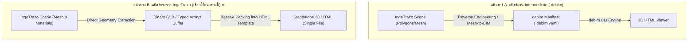
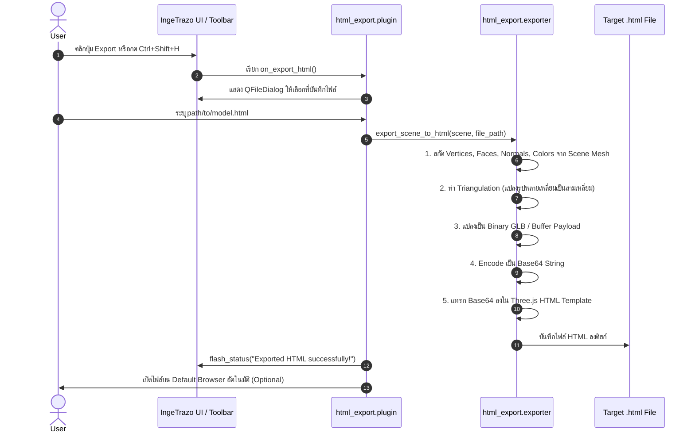

# 📄 Architectural Design Document: `ingetrazo-to-html`
**IngeTrazo Standalone 3D HTML Web Exporter Plugin (`html_export`)**

---

## 1. Executive Summary & Vision

`ingetrazo-to-html` (ติดตั้งในชื่อปลั๊กอิน **`html_export`**) คือส่วนเสริมสำหรับโปรแกรมสร้างโมเดลสถาปัตยกรรมสามมิติ **IngeTrazo 3D Modeler** โดยมีหน้าที่แปลงโมเดลสามมิติที่ผู้ใช้ปั้นเสร็จสมบูรณ์บนหน้าจอ ให้กลายเป็นไฟล์ **Standalone HTML (.html)** เพียงไฟล์เดียว ซึ่งมี WebGL Engine (**Three.js**) และโมเดลสามมิติฝังอยู่ในตัว (Self-Contained Single File)

### Key Value Propositions
* 🌐 **Zero Server & Zero Configuration:** ไม่ต้องมี Web Server (เช่น Apache/Nginx), ไม่ต้องติดตั้ง Node.js หรือ Python บนเครื่องปลายทาง
* 📱 **Everywhere Portability:** ดับเบิลคลิกเปิดไฟล์ `.html` บนเว็บเบราว์เซอร์มาตรฐานใดก็ได้ (Chrome, Safari, Edge, Firefox) ทั้งบนคอมพิวเตอร์ (Windows, macOS, Linux) รวมถึงแท็บเล็ตและสมาร์ตโฟน (iOS, Android)
* 🔒 **Air-Gapped & Offline Ready:** ทำงานได้ 100% แม้ไม่มีสัญญาณอินเทอร์เน็ต ไฟล์ไม่พึ่งพา External CDN และไม่ติดปัญหา CORS Policy ของบราวเซอร์
* ⚡ **One-Click Native Workflow:** ใช้งานสะดวกผ่านเมนู `File > Export 3D HTML...` หรือปุ่มบน Toolbar พร้อมคีย์ลัด `Ctrl+Shift+H`

---

## 2. Architectural Comparison: Direct vs Intermediate

ในการออกแบบระบบ มี 2 แนวทางหลักในการแปลงผลงานจาก IngeTrazo:



### เหตุผลที่เลือกแนวทาง B (Direct Export):
1. **ความสมบูรณ์ของรูปทรง (Geometric Fidelity):** วัตถุที่ผู้ใช้ปั้นใน IngeTrazo อาจเป็นรูปทรงอิสระ (Freeform), เฟอร์นิเจอร์, ส่วนตกแต่ง, หรือภูมิประเทศ ซึ่งไม่มีนิยามตามมาตรฐาน BIM primitives หากต้องแปลงย้อนกลับเป็น `.debim` จะเกิดปัญหาข้อมูลตกหล่น (Semantic Loss) ในขณะที่การแปลง Mesh ตรงๆ รับประกันความเหมือน 100%
2. **ประสิทธิภาพและความเร็ว (Instant Performance):** IngeTrazo มีชุดข้อมูล `scene.mesh` (จุดยอด Vertices, Faces, สี/เลเยอร์) อยู่ในหน่วยความจำ RAM พร้อมใช้งานอยู่แล้ว การสกัดและ Triangulate ทำได้ในเวลาเสี้ยววินาที
3. **ความคล่องตัวของปลั๊กอิน (Lightweight Footprint):** ปลั๊กอินทำงานเป็นเอกเทศ ไม่ต้องแบกรับ Dependency หนักของ BIM Engine

---

## 3. System Architecture & Directory Structure

```
50-export-to-html/ (Repository: ingetrazo-to-html)
├── .gitignore
├── LICENSE                   # MIT License
├── README.md                 # User guide and quick start
├── DESIGN.md                 # Architectural specification (This document)
├── html_export/              # IngeTrazo Plugin Directory
│   ├── __init__.py           # Package entry and versioning
│   ├── metadata.json         # IngeTrazo plugin descriptor
│   ├── plugin.py             # IngeTrazo Tool lifecycle & menu/toolbar wiring
│   ├── exporter.py           # Geometry extraction & HTML compilation engine
│   ├── template.html         # Three.js single-file viewer template
│   └── resources/
│       ├── icon.svg          # 24x24 Vector toolbar icon
│       ├── icon.png          # 24x24 Raster toolbar icon
│       ├── icon_64.png       # 64x64 Medium icon
│       ├── icon_256.png      # 256x256 High-res icon
│       └── icon_highres.svg  # High-definition visual banner icon
└── tools/
    ├── generate_icons.py     # Icon generation utility
    └── package_extension.py  # ZIP packaging tool for release
```

---

## 4. Data Pipeline & Processing Flow

การส่งออกโมเดลดำเนินตามขั้นตอน 4 ระยะดังนี้:



### รายละเอียดทางเทคนิคของแต่ละขั้นตอน:

#### 1. Geometry Extraction
ดึงข้อมูลจาก `app.scene().mesh`:
* **Vertices:** พิกัด $(X, Y, Z)$ ของจุดยอด
* **Faces:** Loop รายการ index ของจุดยอดในแต่ละหน้า
* **Colors / Materials:** ดึงสีประจำเลเยอร์ หรือสีเฉพาะจุด (Vertex / Face Colors) เพื่อให้โมเดลมีสีสันตรงกับใน IngeTrazo

#### 2. Triangulation
หาก Face มีมากกว่า 3 จุดยอด (N-gons เช่น สี่เหลี่ยมหรือรูปหลายเหลี่ยมระนาบ) จะทำการแบ่งเป็นสามเหลี่ยม (Ear-clipping หรือ Fan-triangulation สำหรับ Convex Polygons) เพื่อให้พร้อมสำหรับการเรนเดอร์ใน GPU ของ WebGL

#### 3. Coordinate System Alignment
* **IngeTrazo:** สถาปัตยกรรมใช้พิกัดมือขวาแบบ **Z-up** ($+X$ ขวา, $+Y$ ลึก/เหนือ, $+Z$ สูง)
* **Three.js Standard:** มักใช้พิกัด **Y-up** ($+X$ ขวา, $+Y$ สูง, $+Z$ เข้าหากล้อง)
* **การแมปพิกัด:** ทำการหมุน Transform Matrix หรือสลับแกน $(X, Z, -Y)$ อย่างเป็นระบบ เพื่อให้โมเดลตั้งตรงอย่างเป็นธรรมชาติเมื่อเปิดดูบนเว็บ

#### 4. Single-file Packaging (Base64 Embedding)
* ไลบรารี **Three.js (Core + OrbitControls)** ขนาดกะทัดรัด (Minified) จะถูกฝังลงในแท็ก `<script>` ของเทมเพลตโดยตรง
* ข้อมูล 3D Geometry จะถูกฝังอยู่ในตัวแปร JavaScript ในรูป Base64:
  ```javascript
  const MODEL_DATA = "data:application/octet-stream;base64,GkXfo59ChoEBQveBAULygQRC84EIQoKEd2VibUKHgQRChYECGFOAZwH...";
  ```
* เมื่อเปิดไฟล์ บราวเซอร์จะ decode เป็น `ArrayBuffer` และสร้าง `THREE.BufferGeometry` แสดงผลทันทีใน 1 เฟรม

---

## 5. Web Viewer Features & UX Design

ตัวแสดงผล 3D HTML ที่สร้างขึ้นมา มีฟังก์ชันอำนวยความสะดวกครบครัน:

1. **Camera Controls (กล้องและมุมมอง):**
   * หมุนรอบชิ้นงาน (Rotate): คลิกซ้ายแล้วลาก (หรือ 1 นิ้วบนจอมือถือ)
   * เลื่อนมุมมอง (Pan): คลิกขวาแล้วลาก (หรือ 2 นิ้วบนจอมือถือ)
   * ย่อ/ขยาย (Zoom): เลื่อนลูกกลิ้งเมาส์ (Scroll wheel หรือ Pinch-to-zoom)
2. **Lighting & Shadows (การจัดแสง):**
   * **Ambient Light:** แสงกระจายรอบทิศทาง ป้องกันส่วนมืดทึบ
   * **Key Directional Light:** แสงเงาสามมิติด้านหน้า-บน ให้มิติความลึกที่สมจริง
   * **Fill Light:** แสงเสริมจากด้านล่างเพื่อเน้นขอบโมเดล
3. **Interactive Toolbar Overlay:**
   * 🔄 **Reset Camera:** รีเซ็ตกล้องกลับสู่จุดกึ่งกลางและระยะโฟกัสที่พอดีกับ Bounding Box ของโมเดล
   * 📐 **View Presets:** สลับมุมมองด่วน (Top, Front, Right, Isometric)
   * 🕸️ **Wireframe Toggle:** สลับระหว่างการแสดงผลพื้นผิวทึบ (Solid Shaded) กับเส้นลวดโครงสร้าง (Wireframe)
   * 🎨 **Theme Toggle:** สลับพื้นหลังระหว่าง Dark Studio (ถนอมสายตา), Clean White (สำหรับงานพรีเซนต์), และ Blueprint Grid
   * 📊 **Info Inspector:** แสดงสถิติชิ้นงาน (จำนวน Faces, Vertices, และขนาดความกว้าง-ยาว-สูง $W \times L \times H$)

---

## 6. Icon Design Concept

เพื่อให้เข้ากับชุดเครื่องมือที่ทันสมัยและมินิมอล ไอคอนของปลั๊กอินได้รับการออกแบบภายใต้แนวคิด:

> **"Isometric 3D Wireframe Cube fusing with HTML `< / >` Tags"**

* **สัญลักษณ์ลูกบาศก์ไอโซเมตริก:** สื่อถึงการปั้นโมเดล 3 มิติใน IngeTrazo
* **สัญลักษณ์วงเล็บแท็ก `<` และ `>`:** สลักอยู่บนระนาบด้านข้างทั้งสองของลูกบาศก์ สื่อถึงเทคโนโลยีเว็บ HTML5
* **จุด Node และเส้นเรย์บนระนาบยอด:** สื่อถึงความแม่นยำของพิกัด Geometry
* **ชุดสี:** ใช้โทนสี Cyan / Neon Sky Blue (`#38BDF8`, `#06B6D4`, `#22D3EE`) บนพื้นหลัง Dark Slate ซึ่งเป็นคู่สีสากลของวงการ 3D และ Web Development

---

## 7. Metadata Specification (`metadata.json`)

```json
{
  "id": "html_export",
  "name": "Export 3D HTML",
  "version": "0.1.0",
  "author": "PRIDA-TAKON",
  "license": "MIT",
  "description": "Export completed 3D models from IngeTrazo into standalone Three.js HTML files",
  "min_ingetrazo_version": "0.5.8"
}
```

---

## 8. Deployment & Distribution

### การติดตั้งสำหรับผู้ใช้งานทั่วไป:
1. คัดลอกโฟลเดอร์ `html_export` ไปวางในโฟลเดอร์ปลั๊กอินของ IngeTrazo:
   * **Windows:** `%APPDATA%\ingetrazo\plugins\html_export`
   * **Linux:** `~/.local/share/ingetrazo/plugins/html_export`
   * **macOS:** `~/Library/Application Support/ingetrazo/plugins/html_export`
2. เปิดโปรแกรม IngeTrazo ปลั๊กอินจะปรากฏในเมนู `File > Export 3D HTML...` และบนแถบเครื่องมือหลักทันที
