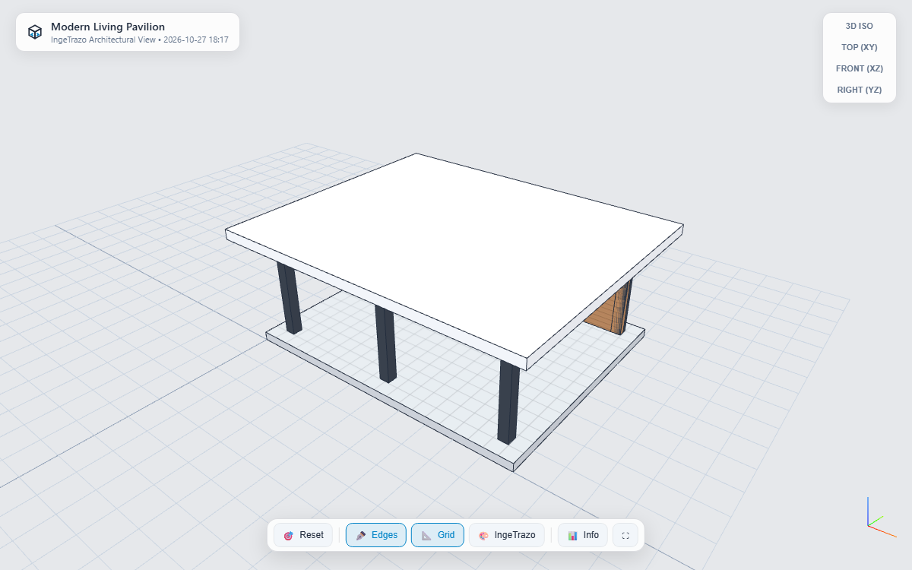

# ingetrazo-to-html 🌐✨

<p align="center">
  
</p>

<p align="center">
  <b>Export completed 3D architectural models from IngeTrazo into standalone Three.js HTML files.</b><br>
  เปิดหมุนดูโมเดล 3D บนบราวเซอร์ได้ทุกเครื่อง ทุกอุปกรณ์ โดยไม่ต้องลงโปรแกรมและไม่ต้องต่อเน็ต
</p>

<p align="center">
  <a href="LICENSE"></a>
  <a href="DESIGN.md"></a>
  
</p>

<p align="center">
  
</p>

---

## 🌟 จุดเด่น (Key Features)

* **100% IngeTrazo Native Visual Look:** ถอดแบบการเรนเดอร์ หน้าตา และเฉดสีออกมาเหมือนใน IngeTrazo 100%:
  - **เส้นขอบคมชัด (IngeTrazo Edges):** สกัดเส้นโครงสร้างและขอบโมเดลทุกเส้น วาดด้วยสี Deep Charcoal Navy (`#212B3B`) แบบไร้การกระพริบ (No Z-fighting ด้วย PolygonOffset)
  - **เฉดสีผิวสถาปัตยกรรม (Matte Shading):** พื้นผิวแบบด้าน ผสมผสานแสง Sunlight ทิศทางเดียวกับ IngeTrazo พร้อมสีเริ่มต้น Warm Plaster White (`#F5F2EC`)
  - **พื้นหลังเอกลักษณ์:** สีเทาสถาปัตยกรรม IngeTrazo Viewport Background (`#E6E8EB`)
  - **สลับสไตล์แบบ Built-in:** รองรับทั้งโหมด IngeTrazo Shaded, Hidden Line (งานแบบขาวดำ), Monochrome, X-Ray (มองทะลุ), และ Dark Studio
* **Single-file Standalone:** ได้ไฟล์ `.html` เพียงไฟล์เดียวที่มี Three.js Engine และข้อมูลโมเดลฝังในตัว (Embedded Base64)
* **Zero Dependencies:** ไม่ต้องใช้ Web Server ไม่ต้องพึ่งพา External CDN และไม่ติดปัญหา CORS Policy ของบราวเซอร์
* **Universal Compatibility:** รองรับทั้ง Chrome, Edge, Safari, Firefox บน PC, Mac, iPad, iPhone, Android
* **Touch & Orbit Controls:** รองรับการหมุน ซูม แพน ทั้งด้วยเมาส์และหน้าจอสัมผัส
* **Studio Tools:** มีปุ่ม Reset View, มุมมองมาตรฐาน (Top, Front, Isometric), สลับโหมด Wireframe และธีมพื้นหลัง (Dark/Light/Grid)
* **Minimalist Icon:** ดีไซน์ไอคอนทรงลูกบาศก์มินิมอลผสมผสานแท็ก `< / >` กลมกลืนกับเครื่องมือของ IngeTrazo

---

## 📦 การติดตั้ง (Installation)

คัดลอกโฟลเดอร์ `html_export` ไปวางในโฟลเดอร์ Plugins ของ IngeTrazo:

### Windows
```powershell
# Copy html_export to IngeTrazo plugins directory
Copy-Item -Recurse html_export "$env:APPDATA\ingetrazo\plugins\html_export"
```

### Linux
```bash
cp -r html_export ~/.local/share/ingetrazo/plugins/
```

### macOS
```bash
cp -r html_export ~/Library/Application\ Support/ingetrazo/plugins/
```

---

## 🚀 วิธีใช้งาน (Usage)

1. เปิดโมเดลหรือปั้นงานใน **IngeTrazo 3D Modeler**
2. คลิกปุ่ม **Export 3D HTML** บน Toolbar (หรือเลือกเมนู `File > Export 3D HTML...` หรือกดคีย์ลัด `Ctrl+Shift+H`)
3. เลือกตำแหน่งที่ต้องการบันทึกไฟล์ เช่น `my_house.html`
4. ไฟล์ HTML จะถูกสร้างขึ้น พร้อมเปิดขึ้นมาบน Web Browser ทันที!

---

## 📐 โครงสร้างโปรเจกต์ (Project Structure)

```text
50-export-to-html/
├── DESIGN.md                 # เอกสารการออกแบบสถาปัตยกรรมอย่างละเอียด
├── README.md                 # เอกสารแนะนำการใช้งาน
├── LICENSE                   # สิทธิ์การใช้งานแบบ MIT
├── html_export/              # ตัวปลั๊กอินสำหรับติดตั้งใน IngeTrazo
│   ├── metadata.json         # ข้อมูลระบุตัวตนของปลั๊กอิน
│   ├── plugin.py             # จุดเชื่อมต่อเมนูและ Toolbar
│   ├── exporter.py           # ตัวสกัด Mesh และสร้าง HTML
│   ├── template.html         # เทมเพลต 3D Web Viewer
│   └── resources/            # ไอคอน SVG / PNG มินิมอล
│       ├── icon.svg
│       ├── icon.png
│       └── icon_highres.svg
└── tools/
    ├── generate_icons.py     # สคริปต์สร้างไอคอน
    └── package_extension.py  # สคริปต์แพ็กเกจเป็น .zip
```

---

## 📄 เอกสารสถาปัตยกรรม (Architecture Documentation)

อ่านรายละเอียดการทำงานของ Data Pipeline, Triangulation, Base64 Encoding และ Three.js Viewer ได้ที่ [DESIGN.md](DESIGN.md)

---

## ⚖️ License

MIT License © 2026 PRIDA-TAKON
